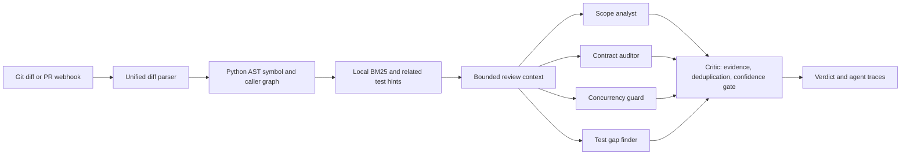

# DiffPulse

DiffPulse reviews unified PR diffs with local structural context before asking specialized agents for findings. It runs on Python 3.11+ with no paid service or credit card. Ollama is the default model provider; offline mock and heuristic modes work without a model.

## Architecture



The parser records changed files, hunks, line numbers, additions, and removals. The AST graph identifies functions, classes, imports, and direct callers; a line-based fallback keeps indexing possible when Python syntax is broken. BM25 retrieves relevant local files and tests. This extraction happens **before** model calls so each agent receives a bounded, reviewable set of facts instead of a repository dump. Agent responses must satisfy strict Pydantic JSON schemas. The critic keeps evidence-backed findings on changed lines whose confidence is at least `REVIEW_CONFIDENCE_THRESHOLD` (default `0.75`).

## Run locally

```bash
python -m venv .venv
.venv/bin/pip install -e '.[dev]'
git diff HEAD~1 HEAD > /tmp/change.diff
.venv/bin/diffpulse review /tmp/change.diff --root .
.venv/bin/diffpulse eval --mock --json
.venv/bin/pytest -q
```

The default review command expects Ollama at `http://localhost:11434` with `qwen2.5-coder:7b`. Configure `OLLAMA_BASE_URL`, `OLLAMA_MODEL`, and other settings through environment variables or a local `.env` copied from `.env.example`. `review --mock` exercises the pipeline and returns no generated findings. `review --heuristic` runs a small offline pattern baseline; it is useful for smoke tests, not a substitute for model review. Each run includes agent errors and token and latency accounting in its JSON output.

Start the API with `.venv/bin/uvicorn pr_reviewer.api.app:app --host 127.0.0.1 --port 8001`. It exposes `GET /health`, `POST /review/diff` with `{"diff": "..."}`, and `POST /webhooks/github`. The webhook accepts GitHub `pull_request` events (`opened`, `reopened`, `synchronize`) with an inline diff for local fixtures or a GitHub `diff_url`. Set `GITHUB_WEBHOOK_SECRET` before exposing the endpoint; set `GITHUB_TOKEN` only if a private PR diff needs authentication. Local runs need neither token nor tunnel.

## Measured evaluation

On 2026-11-24, `.venv/bin/diffpulse eval --mock --json` ran six offline synthetic PR fixtures: four planted findings (race condition, changed API response field, removed idempotency guard, missing zero-count regression test) and two clean changes.

| Measure | Result |
| --- | ---: |
| Precision | 100% (4 true positives, 0 false positives) |
| Recall | 100% (0 false negatives) |
| Clean-PR false-positive rate | 0% (0 of 2) |
| Total benchmark wall time | 0.023 s |
| Token count | 4,186 estimated tokens |

These numbers describe the **heuristic mock on these six fixtures**. Its rules intentionally recognize their planted patterns; they do not establish real-world model accuracy. Mock token counts are character-based estimates. `eval` without `--mock` uses the configured Ollama provider and measures that provider's output against the same expected locations. A finding counts as correct when its file and changed line match an expected finding; the clean-PR false-positive rate is the fraction of clean fixtures with any finding.

For real-diff smoke testing, `review --heuristic` processed the repository's webhook endpoint commit (`1c0fd2f`, `src/pr_reviewer/api/app.py`) and evaluation runner commit (`641890f`, `src/pr_reviewer/eval/runner.py`). Both returned zero findings and no agent errors in 0.176 s and 0.161 s respectively. Manual inspection of the webhook change found a malformed JSON payload case the heuristic missed; the handler now returns HTTP 400 for a non-object payload, with a regression test. Those two unlabeled commits cannot yield a defensible precision or recall figure. Ollama was not installed in this workspace, so no live-model benchmark was run.

## Current scope

The webhook returns a review response; it does not post GitHub comments. The symbol graph resolves direct Python calls and some import aliases, and the heuristic patterns are deliberately narrow. SQLite history and an OpenAI-compatible provider are planned interfaces, not implemented storage or adapters.
